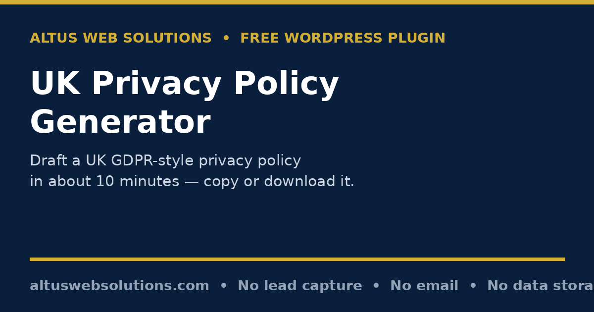

# Altus Privacy Policy Generator — Free WordPress Privacy Policy Generator Plugin

**A free tool that drafts a UK GDPR-style privacy policy for your small business in about 10 minutes: answer 4 short question sets, then copy it or download it as text or HTML — no account, no email, no signup.**

> **⬇️ Download now:** get the latest release zip from the [**Releases page**](../../releases) → WordPress → Plugins → Add New → Upload Plugin → Install Now → Activate → add the shortcode `[altus_privacy_policy_generator]` to any page.

**Keywords people search for:** free privacy policy generator UK, UK GDPR privacy policy generator, WordPress privacy policy plugin, free privacy policy template UK small business, GDPR privacy policy draft, privacy policy generator plugin, generate privacy policy free, UK data protection policy template.

## What it does

If your website collects names, email addresses, phone numbers — or even just messages through a contact form — UK data protection law requires you to tell people what you do with their data, clearly, and before you collect it. Most small-business sites fail that test: they either have no privacy policy at all, or a template copied from another website that names a different company and describes data they don't collect. The first leaves you exposed. The second misleads your visitors, which is arguably worse.

This plugin fixes that. It asks four short sets of questions — about the business, the data collected, the third-party services used, and how long data is kept — and drafts a structured, 12-section, UK GDPR-style privacy policy with the visitor's own details filled in. The draft is shown on screen with a live preview, and the visitor copies it or downloads it as a clean `.txt` or `.html` file. In this open-source version there is no email step at all: nothing is sent anywhere and nothing is stored.

## Who it is for

- **Small-business owners and sole traders** who need a proper privacy policy but don't want to write one from a blank page or copy someone else's.
- **Freelancers, web designers and agencies** who want to offer clients a working draft in minutes instead of a placeholder.
- **Any WordPress site owner** whose site collects enquiries, newsletter signups, analytics or payment details — which, in practice, is almost every business site.

## The problem it solves

Writing a privacy policy from scratch is daunting, which is why most are missing or copied. A copied policy is worse than useless: it describes another business's data practices, contact details and often another country's laws. This generator only writes about what the visitor actually ticks — the data they collect, the services they use, the cookies they set — so the draft describes their business, not a generic one. And because the whole thing runs in the browser, the visitor's answers never leave their own screen.

## Features — and why each one matters

### 4 guided question sets

- **Step 1 — About your business.** Business name, type (limited company, sole trader, partnership, freelancer or charity), website and contact email, plus an optional postal address. Why it matters: these become the "who we are" section, so visitors can identify the data controller — that's the business itself.
- **Step 2 — What personal data do you collect?** A plain-English checklist: names, emails, phone numbers, postal addresses, payment details, account logins, enquiry messages, website usage data and marketing preferences. Why it matters: the policy only lists what is actually ticked. Nothing is invented, nothing is padded "just in case".
- **Step 3 — Third parties & cookies.** The services that touch visitor data — Google Analytics, Meta/Facebook, Google Maps, payment processors, email marketing, hosting, live chat, booking tools — plus whether the site sets cookies and which types (strictly necessary, preference, analytics, marketing), and whether data is transferred outside the UK. Why it matters: named third parties and an honest cookie position are exactly what visitors and regulators look for; hiding them is what gets businesses into trouble.
- **Step 4 — Keeping data & children's privacy.** Retention choices (active customers only, active plus 6 years for tax records, enquiries for 12 months, or a custom description) and whether the business knowingly collects data from children under 13. Why it matters: "as long as necessary" is the legal standard — the policy says what that means in practice for this business, including the tax-record-friendly option if it takes payments.

### A 12-section draft, built from real answers

The generated policy covers: who you are; the data you collect; how and why you use it, with each purpose paired with its UK GDPR lawful basis (contract, legitimate interests, consent, legal obligation) worked out from the answers; who you share it with; cookies; how long you keep data; visitors' rights (access, correction, deletion, objection and more); data security; international transfers; children's privacy; policy changes; and how to contact you or complain to the ICO. The lawful-basis mapping is automatic — the visitor doesn't need to know data-protection law to get a coherent draft.

### Copy and download, on screen, immediately

- **Live document preview** of the full draft, with a section count ("12 sections generated for …").
- **Copy to clipboard** in one click.
- **Download .txt** — a clean plain-text policy, named after the business.
- **Download .html** — a standalone, styled HTML document ready to paste onto a dedicated privacy policy page linked from the footer.
- **Edit my answers** — go back, change anything, regenerate in seconds. There is no penalty for getting an answer wrong the first time.

### Honest disclaimers, built in

Every generated policy carries a prominent note: it is a **draft template, not legal advice**, and should be reviewed by a solicitor before publishing. The plugin repeats that warning in the tool itself, in the downloaded files, and in this README — because data protection depends on the specific circumstances of each business, and no automated tool can guarantee compliance for a situation it hasn't seen.

## How it works

1. Add the shortcode `[altus_privacy_policy_generator]` to a page.
2. The visitor works through the 4 steps (with a progress bar and step dots). Validation is friendly and specific: a missing business name, an invalid website address or an invalid contact email is flagged before moving on, and at least one data type must be ticked.
3. Clicking **Generate my privacy policy** builds the 12-section draft entirely in the visitor's browser — no server round-trip, no form submission, no data leaving the page.
4. The visitor reviews the draft, then copies it or downloads it as `.txt` or `.html`.
5. They paste it onto a dedicated privacy policy page, linked from their footer, and — as the tool itself advises — have it reviewed by a solicitor before publishing.

## Installation (2 minutes, from the release zip)

1. Download the latest `altus-privacy-policy-generator-v1.0.0.zip` from the [**Releases page**](../../releases).
2. In WordPress, go to **Plugins → Add New → Upload Plugin**, choose the zip, click **Install Now**, then **Activate**.
3. Create or edit a page and add the shortcode: `[altus_privacy_policy_generator]`
4. Publish the page. Done — visitors can draft a policy from it in about 10 minutes.

Requires WordPress 5.8+ and PHP 7.4+. No settings page, no API key, no account, no email configuration.

## Frequently asked questions

**Is the Privacy Policy Generator really free?**
Yes. Generating the policy, copying it and downloading it are all free, with no account and no email address required in this open-source version.

**Is this legal advice?**
No. The generator produces a draft template based on your answers, structured around UK GDPR requirements. It is not legal advice, and it can't account for the specifics of your business. Have a solicitor review the policy before you publish it on your website. The output is a draft/template only, NOT legal or financial advice, and you should have it reviewed by a professional where it matters.

**Do I legally need a privacy policy?**
If your website collects personal data — names, emails, phone numbers, enquiry messages, even analytics — UK data protection law requires you to tell people what you're doing with it. In practice, that means a privacy policy. There is no minimum business size: it applies to sole traders as much as limited companies.

**What does the generated policy cover?**
Twelve sections: who you are, the data you collect, how and why you use it (with lawful bases), who you share it with, cookies, how long you keep data, your visitors' rights, data security, international transfers, children's privacy, policy changes, and how to contact you or complain to the ICO.

**Will my answers be sent or stored anywhere?**
No. This GitHub version contains NO lead capture, NO email sending, and NO data storage — results are shown on screen only, and the policy is generated entirely in the visitor's browser. The version hosted on altuswebsolutions.com may offer email delivery; this open-source version does not. There is no email form in this version at all — if you want to keep the draft, use Copy or Download.

**Can I just copy another business's privacy policy instead?**
You can read one for ideas, but publishing a copy is a bad idea: it will describe their data practices, their contact details and often their country's laws — not yours. A generated draft built from your own answers is both easier and more accurate.

**Is a generated policy legally compliant?**
A good generator produces a well-structured draft covering the required ground, but no automated tool can guarantee compliance for your specific situation — that's why a solicitor review before publishing matters. Think of it as expert scaffolding, not the finished building.

**How often should I update my privacy policy?**
Whenever something material changes — new analytics, a new email tool, a new payment provider — and at least once a year as a routine check. Just re-run the generator with your updated answers.

## Honest limits

- The output is a **draft template only, not legal advice** — see the FAQ and the disclaimer below. A solicitor review before publishing is strongly recommended.
- It is structured around **UK GDPR** requirements. It is not a US policy, and it does not cover every sector-specific rule (for example, health, children's services or financial services may need extra clauses).
- It only describes what the visitor tells it. If a service or data type is forgotten in the answers, it won't appear in the policy — so read the draft with fresh eyes and regenerate if anything is missing.
- It does not include a cookie-consent banner, a cookie policy, or terms and conditions — those are separate documents (Altus publishes a separate Cookie Policy Generator on its own site).
- Downloading a file happens in the visitor's browser; the plugin never sees or stores the finished policy.

## Changelog

### 1.0.0
- First public release (stripped open-source version of the Altus Privacy Policy Generator).
- 4-step questionnaire generating a 12-section UK GDPR-style privacy policy, with lawful bases auto-mapped from answers.
- Live on-screen preview, Copy to clipboard, Download .txt and Download .html.
- Email gate, lead storage and email sending removed: no lead table, no visitor email, no owner notification, no server file write.
- Policy generation confirmed fully client-side in this version (no AJAX endpoint remains).
- Version taken from the original plugin header (1.0.0); no version number invented for this release.
- GPL licence added to the plugin header and a WordPress `readme.txt` included alongside this README.

## Data handling — read this before installing

- **What it does:** nothing server-side. The questionnaire runs in the visitor's browser; the policy is built in JavaScript on the visitor's own device and shown on screen.
- **What it does NOT do:** it stores nothing (no database table, no saved files containing user input), sends no email (no policy to the visitor, no notification to the site owner), uploads nothing to the server, and transmits no user-supplied personal data externally at all — there is no external fetch in this plugin.
- The business name, contact email and other answers a visitor types are **their own details, shown back to them in their own draft**; they are never collected by the site owner through this plugin.

## Disclaimer

This software is provided free of charge, "as is", WITHOUT warranty of any kind, express or implied, including but not limited to the warranties of merchantability, fitness for a particular purpose and non-infringement. The authors and contributors are NOT liable for any loss, damage or cost arising from the use of this software, including any loss arising from publishing a policy generated with it. The output is a draft/template only, NOT legal or financial advice, and you should have it reviewed by a professional (for example a solicitor) where it matters, before publishing it or relying on it. Back up your site first and test on staging where possible before installing any plugin on a live site.

## Licence

GPLv2 or later — see [LICENSE](LICENSE). You are free to use, modify and redistribute this plugin under the terms of the GNU General Public License, version 2 or any later version.

---

Built by [Altus Web Solutions](https://altuswebsolutions.com) — the version on altuswebsolutions.com may offer email delivery of the generated policy; this open-source version does not, by design.
